<div align="center">
  <h1>xprobe</h1>
  <p><strong>Bounded latency evidence from CPU, Python, and CUDA processes.</strong></p>
  <p>A bounded Linux profiler for AI coding agents and the humans working with them:<br>
  eBPF + perf + NVIDIA CUPTI, one CLI, strict JSON, no daemon.</p>
  <p>
    <a href="https://github.com/itdevwu/xprobe/actions/workflows/ci.yml"></a>
    <a href="https://github.com/itdevwu/xprobe/releases"></a>
    <a href="LICENSE"></a>
    <a href="#support"></a>
  </p>
</div>

<p align="center">
  <picture>
    <source media="(prefers-color-scheme: dark)" srcset="docs/assets/xprobe-flow-dark.svg">
    
  </picture>
</p>

<p align="center"><sub>Real numbers from the v0.6.0 release gate on an RTX 3060: a request → launch → kernel path.</sub></p>

## What it does

Point xprobe at a running process or an earlier capture and ask a specific
question. It records one bounded window of exactly the evidence that question
needs and returns strict JSON plus the raw events, so you or your AI agent can
analyze them however the problem demands:

- **Latency between any two events** — a function, syscall, CUDA API call,
  kernel, copy, or NVTX range — or a whole request → launch → kernel path of up
  to eight edges from one capture, each pairing labeled with its confidence.
- **Where time goes**: sampled native and CPython stacks, the GIL holder read
  from outside the process, syscall time, and kernel, copy, and memset
  inventories with pinned and pageable copies.
- **GPU timelines**: device idle time kept apart from gaps on one stream,
  compute versus communication time per GPU, and side-by-side budgets for the
  ranks of a data- or tensor-parallel job.
- **Rare spikes**: a triggered capture waits for one slow span — a device idle
  bubble, a stream gap, a long kernel, or a slow edge — and writes only the
  window around it.
- **A quick broad look**: `--triage` runs several of these at once with
  rule-based hints, useful as a reference before choosing what to measure.

It is built for agents: an [Agent Skill](skills/xprobe-measure-latency/SKILL.md)
for Claude Code, Codex, and Cursor describes every artifact's fields instead of
prescribing a procedure. Every capture is bounded by samples or duration,
timeout, and capacity; there is no daemon; CUDA injection is disclosed before
it happens; and anything a capture cannot answer is said, not guessed.

## Install

Install the version-matched Skill with the open Agent Skills CLI. This is the
only installation action required from the user:

```bash
npx skills@1 add \
  https://github.com/itdevwu/xprobe/tree/v0.7.0-dev.1/skills/xprobe-measure-latency \
  --global
```

The installer detects Codex, Claude Code, Cursor, and other compatible agents.
When invoked, the Skill checks for the matching `xprobe` CLI and installs or
repairs it under a writable prefix before profiling. It can then diagnose and
adjust path, permission, NVIDIA, CUDA, or CUPTI problems from live evidence.
Node.js is only needed for Skill installation, not for xprobe itself.

To install only the CLI, use pip or the release archive:

```bash
pip install xprobe
```

See [Installation](docs/installation.md) for the release archive, SPDX SBOMs,
and GitHub-hosted build attestation verification.

## Measure

Measure a known boundary, or several related boundaries from one capture with
a [measurement graph](docs/cli-contract.md#measurement-graphs):

```bash
xprobe measure --pid 4242 \
  --from 'cuda:launch_api:exit' \
  --to 'cuda:kernel_start:name~flash.*' \
  --match exact --samples 100
```

Wait for a rare GPU bubble, or sample what Python runs:

```bash
xprobe measure --pid 4242 --trigger-idle-ms 10 --timeout-ms 300000 --events-out spikes
xprobe measure --pid 4242 --python-sample --duration-ms 2000
```

Output is JSON whenever stdout is not a terminal. Results carry latency
statistics, a `good`/`caution` quality verdict, rank exemplar pairs, and the
path of the bounded event capture with its manifest. `measure --input`
re-correlates the capture offline, and the Skill's `analyze_trace.py`
summarizes GPU time per device and compares ranks. See the
[CLI contract](docs/cli-contract.md) for every mode, including `--triage`.

## Public CLI

| Command | Purpose |
| --- | --- |
| `doctor` | Report local eBPF, ptrace, NVIDIA, CUDA, and CUPTI capabilities |
| `discover` | List NVML-confirmed CUDA context holders under a process-tree root |
| `validate` | Check an event pair, graph, or inventory mode without attaching |
| `measure` | Correlate, inventory, trigger on, or triage bounded live or recorded evidence |

`measure --pid` automatically loads the matching CUDA 12 or CUDA 13 CUPTI Agent
when a selected endpoint requires it. It reports the target mutation on stderr
and in JSON, disables collection afterward, and leaves the shared object mapped
for safe reactivation. NVTX ranges are the exception: set
`NVTX_INJECTION64_PATH` before the target's first NVTX call because online
attach cannot retrofit an initialized NVTX dispatch.

## Support

| Surface | Current support |
| --- | --- |
| OS/architecture | Linux x86_64, glibc 2.34 or newer |
| Triage | One reference window of thread time, cgroup throttling, CPU and Python samples, syscalls, NVML health, and CUDA kernels |
| Triggered capture | Device idle, stream gap, activity duration, or CUDA edge latency over a ring of recent activity |
| Python sampling | CPython 3.9–3.14 stacks and GIL holder, read from outside the process |
| Multi-GPU | Per-device budgets with GPU UUIDs; per-rank comparison on one host |
| Measurement graphs | Up to eight edges from one capture |
| CPU inventory | PID-scoped sampled user stacks with native ELF and CPython perf-map symbols |
| Host events | ELF functions, named syscall/tracepoint boundaries, and CPython GC USDT |
| Coarse aggregation | Bounded syscall lifecycle and CUDA kernel/memcpy/memset groups, with pageable/pinned copies |
| CUDA callbacks | Runtime and Driver API entry/exit |
| GPU activity | Kernel, memcpy, and memset start/end |
| Application ranges | Bounded ASCII NVTX thread and process ranges |
| CUDA/CUPTI | 12.x and 13.x with automatic major selection |
| Correlation | exact, first-after, nearest, stack-nested, stream-order |
| Online injection | same mount namespace; ptrace permission required |

GPU-to-GPU durations remain available across the supported majors. Cross
CPU/GPU subtraction requires the Agent's runtime alignment check to pass;
otherwise `measure` returns `CLOCK_ALIGNMENT_FAILED` rather than treating an
offset CUPTI clock as host monotonic.

## Documentation

- [Installation](docs/installation.md)
- [Architecture](docs/architecture.md)
- [CLI contract](docs/cli-contract.md)
- [CUPTI agent and injection](docs/cupti-agent.md)
- [Development and hardware tests](docs/development.md)
- [Releasing](docs/releasing.md)
- [Agent integration](docs/agent-integration.md)
- [Public JSON schemas](schemas/)

Source builds and hardware tests are documented under
[Development](docs/development.md). Implemented behavior is defined by code,
tests, and schemas. Licensed under Apache-2.0.
