<div align="center">
  <h1>xprobe</h1>
  <p><strong>Find out why your CPU, Python, or CUDA process is slow — in two commands.</strong></p>
  <p>A bounded Linux profiler for AI coding agents and the humans working with them:<br>
  eBPF + perf + NVIDIA CUPTI, one CLI, strict JSON, no daemon.</p>
  <p>
    <a href="https://github.com/itdevwu/xprobe/actions/workflows/ci.yml"></a>
    <a href="https://github.com/itdevwu/xprobe/releases"></a>
    <a href="LICENSE"></a>
    <a href="#support"></a>
  </p>
</div>

<p align="center">
  <picture>
    <source media="(prefers-color-scheme: dark)" srcset="docs/assets/xprobe-flow-dark.svg">
    
  </picture>
</p>

<p align="center"><sub>Real numbers from the v0.6.0 release gate on an RTX 3060: a PyTorch CUDA workload and a request → launch → kernel path.</sub></p>

## What it does

Point xprobe at a running process. It watches one bounded window and tells you
where the time went — on-CPU hotspots, threads waiting for a CPU or blocked,
container CPU throttling, hot syscalls, GPU kernels, and GPU clock limits —
ranked by impact, each with a ready next measurement. The second command then
measures that exact latency: a function, a syscall, a CUDA API call, a kernel,
a copy, an NVTX range, or a whole request → launch → kernel path from a single
capture.

- **Built for AI agents.** Ships as an [Agent Skill](skills/xprobe-measure-latency/SKILL.md)
  for Claude Code, Codex, and Cursor. Compact JSON with a `good`/`caution`
  quality verdict, so an agent can act on results without reading 100 KB of
  events.
- **CPU, Python, and GPU in one tool.** Sampled native and CPython stacks,
  eBPF uprobes, syscalls, tracepoints, CPython GC, and CUDA 12/13 activity via
  CUPTI, correlated with explicit confidence.
- **Bounded by design.** Every capture is limited by samples or duration,
  timeout, and capacity; there is no daemon; CUDA injection is disclosed
  before it happens; the raw events are always kept for offline re-analysis.
- **Honest about what it knows.** Sampled shares are estimates, temporal
  matches are labeled heuristic, and anything a capture cannot answer is listed
  as not covered.

## Install

Install the version-matched Skill with the open Agent Skills CLI. This is the
only installation action required from the user:

```bash
npx skills@1 add \
  https://github.com/itdevwu/xprobe/tree/v0.6.0/skills/xprobe-measure-latency \
  --global
```

The installer detects Codex, Claude Code, Cursor, and other compatible agents.
When invoked, the Skill checks for the matching `xprobe` CLI and installs or
repairs it under a writable prefix before profiling. It can then diagnose and
adjust path, permission, NVIDIA, CUDA, or CUPTI problems from live evidence.
Node.js is only needed for Skill installation, not for xprobe itself. See
[Installation](docs/installation.md) for direct CLI use, SPDX SBOMs, and
GitHub-hosted build attestation verification.

## Measure

Triage an unknown process over one representative window. Findings are ranked
by their estimated share of the window, and each carries a ready next step:

```bash
xprobe measure --pid 4242 --triage --duration-ms 2000 > triage.json
jq '.findings[0].next.spec' triage.json > next.json
xprobe measure --spec next.json
```

Measure a known boundary directly, or several related boundaries from one
capture with a [measurement graph](docs/cli-contract.md#measurement-graphs):

```bash
xprobe measure --pid 4242 \
  --from 'cuda:runtime_api:cudaLaunchKernel:exit' \
  --to 'cuda:kernel_start:name~flash.*' \
  --match exact --samples 100
```

Output is JSON whenever stdout is not a terminal. Results carry latency
statistics, a `good`/`caution` quality verdict, rank exemplar pairs, and the
path of the bounded event capture, which `measure --input` re-correlates
offline. See the [CLI contract](docs/cli-contract.md) for every mode.

## Public CLI

| Command | Purpose |
| --- | --- |
| `doctor` | Report local eBPF, ptrace, NVIDIA, CUDA, and CUPTI capabilities |
| `discover` | List NVML-confirmed CUDA context holders under a process-tree root |
| `validate` | Check an event pair, graph, or inventory mode without attaching |
| `measure` | Triage, inventory, or correlate bounded live or recorded evidence |

`measure --pid` automatically loads the matching CUDA 12 or CUDA 13 CUPTI Agent
when a selected endpoint requires it. It reports the target mutation on stderr
and in JSON, disables collection afterward, and leaves the shared object mapped
for safe reactivation. NVTX ranges are the exception: set
`NVTX_INJECTION64_PATH` before the target's first NVTX call because online
attach cannot retrofit an initialized NVTX dispatch.

## Support

| Surface | Current support |
| --- | --- |
| OS/architecture | Linux x86_64, glibc 2.34 or newer |
| Triage | One window of thread time, cgroup throttling, CPU samples, syscalls, NVML health, and CUDA kernels |
| Measurement graphs | Up to eight edges from one capture |
| CPU inventory | PID-scoped sampled user stacks with native ELF and CPython perf-map symbols |
| Host events | ELF functions, named syscall/tracepoint boundaries, and CPython GC USDT |
| Coarse aggregation | Bounded syscall lifecycle and CUDA kernel/memcpy/memset groups, with pageable/pinned copies |
| CUDA callbacks | Runtime and Driver API entry/exit |
| GPU activity | Kernel, memcpy, and memset start/end |
| Application ranges | Bounded ASCII NVTX thread and process ranges |
| CUDA/CUPTI | 12.x and 13.x with automatic major selection |
| Correlation | exact, first-after, nearest, stack-nested, stream-order |
| Online injection | same mount namespace; ptrace permission required |

GPU-to-GPU durations remain available across the supported majors. Cross
CPU/GPU subtraction requires the Agent's runtime alignment check to pass;
otherwise `measure` returns `CLOCK_ALIGNMENT_FAILED` rather than treating an
offset CUPTI clock as host monotonic.

## Documentation

- [Installation](docs/installation.md)
- [Architecture](docs/architecture.md)
- [CLI contract](docs/cli-contract.md)
- [CUPTI agent and injection](docs/cupti-agent.md)
- [Development and hardware tests](docs/development.md)
- [Releasing](docs/releasing.md)
- [Agent integration](docs/agent-integration.md)
- [Public JSON schemas](schemas/)

Source builds and hardware tests are documented under
[Development](docs/development.md). Implemented behavior is defined by code,
tests, and schemas. Licensed under Apache-2.0.
